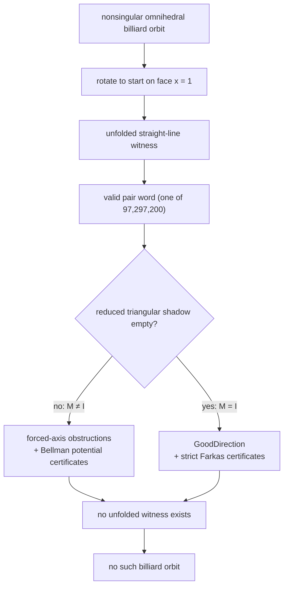

<div align="center">

# Omnihedral Billiards in the Cuboctahedron

**Can a billiard ball inside a cuboctahedron follow a periodic path that bounces off<br>
each of the fourteen faces exactly once per period?**

A Lean 4 / mathlib formalization built on exact rational arithmetic and machine-checked certificates.

[](lean-toolchain)
[](lake-manifest.json)
[](#status)

</div>

<p align="center">
  
  <br>
  <sub><i>Unfolding: instead of reflecting the trajectory at each face, reflect the solid. The billiard path becomes a straight line.</i></sub>
</p>

---

## Overview

A billiard trajectory in a convex polyhedron moves in straight lines and reflects
specularly off the faces. Call a periodic trajectory **omnihedral** if, during one
period, it reflects exactly once off every face. Call it **nonsingular** if every
reflection occurs in the relative interior of a face, never on an edge or at a
vertex.

This repository is building a machine-checked proof of the following statement.

> **Theorem (target).** The cuboctahedron has no nonsingular omnihedral periodic
> billiard trajectory.

The statement was first suggested by an exhaustive floating-point computer search,
which is kept, untrusted, in [`scripts/old_float_verifiers/`](scripts/old_float_verifiers).
This project replaces that search with a proof that the Lean kernel checks, using exact
rational and integer arithmetic only. It uses no floating point, no numerical
tolerances, no `native_decide`, and no custom axioms. External programs may propose
certificates, but Lean must check every one. As far as the author knows, the question
has not been settled before, so a complete formalization would be a new result.

## Status

> [!IMPORTANT]
> The main theorem is currently proved **conditionally**. Everything from the
> billiard model down to an explicit finite coverage obligation is machine-checked.
> Discharging that obligation for all 97,297,200 cases is the remaining work.

| Component | Lean status |
| --- | --- |
| Exact cuboctahedron, face reflections, and billiard orbits | Checked |
| Rotation to a canonical first face; billiard orbit ⇒ unfolded straight-line witness | Checked |
| Enumeration: exactly 97,297,200 started pair words, with a verified rank/unrank bijection | Checked |
| Holonomy classifier: the return map is linear-identity ⇔ the reduced triangular shadow is empty | Checked |
| Obstruction soundness: forced-axis certificates, `GoodDirection`, strict 2-D Farkas, Bellman potentials | Checked |
| Main theorem, assuming complete coverage | Checked |
| Complete coverage of every case | **Open**: checked end to end only on a pilot window (ranks 0–7) |

The theorems in the table depend only on Lean's standard axioms
(`propext`, `Classical.choice`, `Quot.sound`).

**What remains.** Lean already reduces each branch of the case split to a single
residual hypothesis:

1. **Nonidentity branch.** Early obstructions (a forced crossing direction with the
   wrong sign, or a forced face sequence that is not omnihedral) are disposed of by
   checked family theorems. The residual words,
   2,038,656 of them by an exact external count, need Lean-checked obstruction
   certificates. The active route uses finite-state *Bellman potential*
   certificates that cover whole semantic families of words at once instead of
   issuing one certificate per word.
2. **Translation branch.** Each identity-linear signed case that passes the
   `GoodDirection` test needs a strict two-variable Farkas infeasibility
   certificate. The inequality rows are rebuilt in Lean from the geometry. Only the
   multipliers come from outside, and Lean checks them.

Producing one certificate per case does not scale in Lean, so the current work
compresses coverage by mathematical structure (holonomy normal form, cancellation
skeletons, finite-state potentials) instead.

## The formal statement

The billiard model is deliberately elementary and lives in about 460 lines of
definitions:

```lean
-- Cuboctahedron/Geometry/BilliardOrbit.lean (abridged; index casts omitted)
structure BilliardOrbit14 where
  p    : Fin 15 → Vec3 ℝ     -- impact points p₀ … p₁₄
  v    : Fin 15 → Vec3 ℝ     -- velocity leaving each impact
  face : Fin 14 → Face       -- face struck at each impact
  time : Fin 14 → ℝ          -- flight times
  time_pos         : ∀ i, 0 < time i
  impact_interior  : ∀ i, InFaceInterior (face i) (p i)
  next_point       : ∀ i, p (i+1) = p i + time i • v i
  segment_valid    : ∀ i, SegmentTravelValid (p i) (p (i+1))   -- stays inside the solid
  reflection_law   : ∀ i, v (i+1) = reflectVec (v i) (normalR (face (i+1)))
  p_periodic       : p 14 = p 0
  v_periodic       : v 14 = v 0
  ...

def BilliardOrbit14.TouchesEachFaceExactlyOnce (o : BilliardOrbit14) : Prop :=
  Function.Bijective o.face
```

The target theorem is

```lean
theorem cuboctahedron_no_omnihedral :
    ¬ ∃ o : BilliardOrbit14,
        o.Nonsingular ∧ o.Periodic ∧ o.TouchesEachFaceExactlyOnce
```

and the theorem currently proved is

```lean
-- Cuboctahedron/ConditionalTheorem.lean
theorem Cuboctahedron.conditional_cuboctahedron_no_omnihedral
    (coverage : ExhaustiveGeneratedCoverage) :
    ¬ ∃ o : BilliardOrbit14,
        o.Nonsingular ∧ o.Periodic ∧ o.TouchesEachFaceExactlyOnce
```

`ExhaustiveGeneratedCoverage` states that every case of the finite case split
(defined below) has a certificate accepted by a Lean-verified checker. The
generated-evidence pipeline targets a semantic variant,
`Generated.SemanticExhaustiveGeneratedCoverage`, which yields the same conclusion
through `Generated.no_unfolded_omni_starting_xp_of_semantic_coverage`.

**Auditing the statement.** To confirm that the theorem says what it claims, you
only need to read the definitions it mentions:
[`Basic/Vec3.lean`](Cuboctahedron/Basic/Vec3.lean),
[`Geometry/Faces.lean`](Cuboctahedron/Geometry/Faces.lean),
[`Geometry/Polyhedron.lean`](Cuboctahedron/Geometry/Polyhedron.lean),
[`Geometry/Reflection.lean`](Cuboctahedron/Geometry/Reflection.lean), and
[`Geometry/BilliardOrbit.lean`](Cuboctahedron/Geometry/BilliardOrbit.lean).
The kernel checks everything else.

## How the proof works

### 1. An exact model

The cuboctahedron is the rational polytope

```math
P = \left\{ (x,y,z) \in \mathbb{R}^3 \;:\; |x|,|y|,|z| \le 1,\quad \pm x \pm y \pm z \le 2 \right\},
```

with six square faces $\pm x = 1$, $\pm y = 1$, $\pm z = 1$ and eight triangular faces
$`\epsilon_1 x + \epsilon_2 y + \epsilon_3 z = 2`$. Each face is a rational normal $n$
and offset $c$, and reflection in its plane is the affine map

```math
r_F(p) = p - 2\,\frac{n \cdot p - c}{n \cdot n}\, n ,
```

whose coefficients are all rational. Every finite computation in the proof is exact.

### 2. Unfolding

Reflecting the solid instead of the trajectory turns a billiard path into a straight
line through a chain of reflected copies of $P$. Composing the fourteen face
reflections of one period gives an affine return map $A(p) = Mp + b$. Periodicity
forces $A$ to carry the unfolded line to itself, so its direction $v$ satisfies
$Mv = v$. Because an omnihedral orbit meets every face once, it can be rotated so
that it starts on the face $x = 1$ (`can_start_at_xp`). Lean then proves the half of
the unfolding correspondence that nonexistence requires: every omnihedral orbit
that starts on $x = 1$ yields an unfolded witness (`billiard_implies_unfolded`).

### 3. A finite search space

Opposite faces are parallel, so they induce the same linear reflection. Forgetting
which face of each opposite pair is hit turns a started itinerary into a **pair word**
of length 13 over seven letters, three square pairs $x, y, z$ and four triangular
pairs, with multiplicities $x{:}1$ and $2$ for each of the other six letters. Lean
proves that there are exactly

```math
\frac{13!}{2^6} = 97{,}297{,}200
```

such words (`validPairWord_card_literal`) and gives a verified rank/unrank bijection.
Six sign bits, a *sign mask*, recover the original faces when they are needed.

### 4. The holonomy normal form

The linear part $M$ depends only on the pair word, and a normal form decides exactly
when $M = I$. Square-pair reflections are diagonal sign changes, tracked by a parity
vector in $(\mathbb{Z}/2)^3$. Triangular reflections are recorded, after conjugation
by the current parity, on a stack of four projective letters on which adjacent equal
letters cancel. The result is the *reduced triangular shadow*.

> **Theorem** (`totalLinearOfPairWord_eq_identity_iff_reducedShadow_empty_of_valid`).
> For every valid pair word $w$, the linear part $M(w)$ equals $I$ if and only if the
> reduced shadow $\mathrm{red}(w)$ is empty.

The proof has four parts. Valid letter counts force the final square parity to be
trivial. A scan invariant factors the product into a triangular part times a parity
part. Cancellation preserves the triangular product. Finally, a nonempty reduced
word cannot multiply to $I$: for a triangular normal $`n \in \{\pm 1\}^3`$, the scaled
reflection $`3H_n = 3I - 2nn^\top`$ is congruent to the rank-one matrix $nn^\top$ modulo 3.
Distinct adjacent letters have nonzero dot products in $`\mathbb{F}_3`$, so the reduced
product is nonzero mod 3, whereas $3^m I$ vanishes mod 3.

This theorem replaces what was once an untrusted external search result with about
1,250 lines of checked algebra, and it splits the problem into two branches.

### 5. The nonidentity branch ($M \ne I$)

If $A$ preserves the line $`p_0 + \mathbb{R}v`$ with $M \ne I$, then

```math
Mv = v, \qquad (I - M)\,p_0 = b - \lambda v \quad \text{for some } \lambda .
```

This *forced-axis* condition pins the trajectory down to an essentially unique
candidate, and most words fail at once. There may be no compatible fixed direction,
the crossing direction may have the wrong sign, the forced face sequence may not be
omnihedral, or the axis may miss the interior of the start face or of a later face.
Each failure mode has a Lean-checked certificate format (`checkNonIdCert_sound`).

For the hard residual families, the project uses **Bellman potential certificates**.
These are finite graphs with integer edge gains and an integer potential $V$
satisfying $g + V(t) \le V(s)$ on every edge. The inequalities telescope along any
accepted path (`const_add_bellmanGainSum_nonpos_of_path`), which bounds an exact
geometric margin by $0$ for an entire language of words at once and contradicts
feasibility.

### 6. The translation branch ($M = I$)

Now $A(p) = p + b$ is a translation. Writing the start point as $(1, y, z)$, all
crossing-order and face-interior conditions become strict rational linear
inequalities in $y$ and $z$. Two checked tools dispose of these cases:

- **`GoodDirection`.** Every unfolded face must be crossed forwards. Lean proves this
  is necessary (`goodDirection_of_translation_feasible_at_rank`), so sign masks that
  fail it need no certificate.
- **Strict Farkas certificates.** Nonnegative rational multipliers that cancel the
  $y$ and $z$ coefficients and leave a nonpositive constant refute the system
  (`FarkasCert.Valid.sound`). Each row is rebuilt in Lean from its geometric source,
  such as a start-face, ordering, or impact-interior condition.

### 7. Assembly



### The scale of the case split

| Quantity | Count | Source |
| --- | ---: | --- |
| Started valid pair words | 97,297,200 | Lean theorem |
| … with $M \ne I$ (nonempty reduced shadow) | 94,829,112 | exact external scan |
| … with $M = I$ (empty reduced shadow) | 2,468,088 | exact external scan |
| Signed translation cases (2,468,088 × 64 masks) | 157,957,632 | arithmetic |
| Nonidentity residual after early obstructions | 2,038,656 | exact external classifier |
| Translation cases passing direction tests | 6,003,984 | original floating-point search |
| Feasible orbits found | 0 | original floating-point search |

These counts guide the engineering, and none of them is an input to the proof. In
particular, the identity/nonidentity split is decided inside Lean by the holonomy
classifier, not by the scan.

## Repository layout

```text
Cuboctahedron/
├── Basic/          exact Vec3 / Mat3 / Aff3 arithmetic
├── Geometry/       faces, reflections, billiard orbits, unfolding (the statement lives here)
├── Search/         enumeration, holonomy normal form, certificate and obstruction theory
├── Generated/      machine-generated certificate modules and coverage assembly
└── ConditionalTheorem.lean
paper/              expository write-up (LaTeX)
docs/               technical reports and development history
scripts/            untrusted generators and profilers, plus the archived float search
evidence/           proof-carrying shards checked outside the default build
```

| Module | Contents |
| --- | --- |
| [`Geometry/UnfoldingFeasible.lean`](Cuboctahedron/Geometry/UnfoldingFeasible.lean) | billiard orbit ⇒ unfolded witness |
| [`Search/Enumeration.lean`](Cuboctahedron/Search/Enumeration.lean) | pair-word count and rank/unrank |
| [`Search/Itineraries.lean`](Cuboctahedron/Search/Itineraries.lean) | started itineraries ⇒ pair words |
| [`Search/ShadowNormalForm*.lean`](Cuboctahedron/Search/ShadowNormalFormClassifier.lean) | holonomy normal form and identity classifier |
| [`Search/NonIdentityCase.lean`](Cuboctahedron/Search/NonIdentityCase.lean), [`Search/Certificates.lean`](Cuboctahedron/Search/Certificates.lean) | forced-axis geometry and certificate soundness |
| [`Search/BellmanPotential.lean`](Cuboctahedron/Search/BellmanPotential.lean) | generic potential/telescoping theorems |
| [`Search/TranslationGoodDirection.lean`](Cuboctahedron/Search/TranslationGoodDirection.lean) | `GoodDirection` necessity |
| [`Search/Farkas2D.lean`](Cuboctahedron/Search/Farkas2D.lean), [`Search/TwoSourceFarkas.lean`](Cuboctahedron/Search/TwoSourceFarkas.lean) | strict Farkas soundness and source-indexed rows |
| [`Generated/ExhaustiveCoverage.lean`](Cuboctahedron/Generated/ExhaustiveCoverage.lean) | coverage interfaces and the final assembly theorem |
| [`ConditionalTheorem.lean`](Cuboctahedron/ConditionalTheorem.lean) | the main theorem, conditional on coverage |

Most of the roughly 6,500 Lean files are generated pilot and smoke modules under
`Generated/`. The main theorem itself depends on only 19 project modules, about
12,000 lines.

## Building and checking

Install [elan](https://github.com/leanprover/elan). The toolchain version is pinned in
[`lean-toolchain`](lean-toolchain).

```bash
git clone https://github.com/zpconn/cuboctahedron.git
cd cuboctahedron
lake exe cache get                              # download prebuilt mathlib
lake build Cuboctahedron.ConditionalTheorem     # build the main theorem
lake env lean Cuboctahedron/PrintConditionalAxioms.lean
```

The axiom check should print:

```text
'Cuboctahedron.conditional_no_unfolded_omni_starting_xp' depends on axioms: [propext, Classical.choice, Quot.sound]
'Cuboctahedron.conditional_cuboctahedron_no_omnihedral' depends on axioms: [propext, Classical.choice, Quot.sound]
```

The forbidden-feature audit is

```bash
grep -R "sorry\|admit\|axiom\|native_decide\|unsafe" Cuboctahedron
```

It should match only the `#print axioms` commands and an ordinary English use of
"admit" in a comment.

> [!NOTE]
> The default `lake build` target builds the certificate infrastructure and the
> bounded evidence root, but it does not import the conditional theorem, so build
> that target explicitly as shown above. The repository is large (about 0.7 GB of
> Git history), mostly because of generated modules.

## Trust model

**Trusted:** the Lean 4 kernel, mathlib, and the short list of definitions the
statement depends on. Every other step is a theorem the kernel checks, including
the unfolding, the enumeration, the holonomy classifier, the soundness of every
certificate format, and the generated modules that apply them.

**Not trusted:** Python profilers and generators, the archived C++ search, JSON
manifests, Markdown reports, and every count quoted in this README. These tools can
find certificates and measure the search space. A certificate becomes part of the
proof only when a Lean theorem consumes it.

The project rules in [`AGENTS.md`](AGENTS.md) enforce this boundary. They forbid
floating point and tolerances in proof code, `sorry`, `admit`, custom axioms,
`unsafe`, and `native_decide`. They also require that any generated data be
covered by a Lean proof that it matches a complete finite enumeration.

## Further reading

- [`paper/cuboctahedron_no_omnihedral.tex`](paper/cuboctahedron_no_omnihedral.tex):
  a self-contained expository account of the reduction and proof architecture.
- [`docs/`](docs/README.md): technical reports on the normal form, the nonidentity
  residuals, and the Bellman certificate route.
- [`docs/history/`](docs/history/README.md): the project's planning documents and
  development logs, kept for the record.

## Acknowledgements

This project was developed with extensive help from AI coding assistants, notably
OpenAI Codex, for Lean proof engineering, search scripts, and exposition. That is
one reason for the strict trust model: no claim in the repository counts unless the
Lean kernel checks it.
